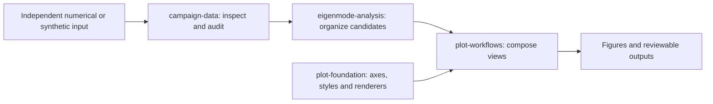

# Photonics, scientific computing, and research tools

[中文](README.zh-CN.md) · [Website](https://my1ab.fyi/en) · [All repositories](https://github.com/Patr1ck2005?tab=repositories) · [Visual guide](docs/visual-guide.md)

I work across photonics, numerical analysis, scientific visualization, and the tools that connect them. I also build interactive experiments and games.

[Three-minute captioned tour](docs/demo/research-tools-tour.mp4) · [Verified downloads](docs/downloads.md) · [How the tools fit together](docs/tools-overview.md)

*Synthetic numerical illustrations, generated from the [included source](scripts/render_overview.py). These are mathematical examples, not unpublished research results or algorithm benchmarks.*

## Selected work

| Project | What it helps with |
|---|---|
| [eigenmode-analysis](https://github.com/Patr1ck2005/eigenmode-analysis) | Organize candidate eigenvalues along paths and grids; retain missing observations and inspect diagnostics. |
| [plot-workflows](https://github.com/Patr1ck2005/plot-workflows) | Turn numerical arrays into related band, quality-factor, polarization and multi-slice views. |
| [MyOptics](https://github.com/Patr1ck2005/MyOptics) | Explore optical fields, components and numerical propagation within the documented approximations. |
| [gds-layout-kit](https://github.com/Patr1ck2005/gds-layout-kit) | Generate parameterized GDS layouts and inspect their geometry. |
| [EM-Flow](https://github.com/Patr1ck2005/EM-Flow) | Explore electromagnetic-wave simulations through an interactive browser interface; see the repository for upstream attribution. |
| [Spirefall](https://github.com/Patr1ck2005/spirefall) | A game project with its own playable-build and development status. |

## A small scientific toolchain

This diagram describes the roles of public components. Each project documents its supported versions and actual examples; it is not a claim that every optional integration is already available.

## Project directory

**Scientific analysis and visualization**

- [eigenmode-analysis](https://github.com/Patr1ck2005/eigenmode-analysis) — path/grid tracking and candidate grouping.
- [campaign-data](https://github.com/Patr1ck2005/campaign-data) — inspect, audit and organize parameter-scan files.
- [plot-foundation](https://github.com/Patr1ck2005/plot-foundation) — reusable scientific plotting primitives and explicit export.
- [plot-workflows](https://github.com/Patr1ck2005/plot-workflows) — reusable analysis-to-figure workflows.
- [MyOptics](https://github.com/Patr1ck2005/MyOptics) — numerical optics.
- [gds-layout-kit](https://github.com/Patr1ck2005/gds-layout-kit) — parameterized layout generation.
- [EM-Flow](https://github.com/Patr1ck2005/EM-Flow) — interactive wave simulation, building on attributed upstream work.
- [EM-Visulization](https://github.com/Patr1ck2005/EM-Visulization) — electromagnetic visualization; consult the current source-availability note.

**Software and interactive exploration**

- [cs-demo-analyzer](https://github.com/Patr1ck2005/cs-demo-analyzer) — game-demo analysis.
- [Guandan-Intelligent](https://github.com/Patr1ck2005/Guandan-Intelligent) — card-game rules and decision-making experiments.
- [Golf-Exploration](https://github.com/Patr1ck2005/Golf-Exploration) — interactive trajectory exploration.
- [numerical-psychology](https://github.com/Patr1ck2005/numerical-psychology) — phenomenological toy models, not empirical psychology.
- [Physics-Puzzle](https://github.com/Patr1ck2005/Physics-Puzzle) — physics-based game exploration.
- [spirefall](https://github.com/Patr1ck2005/spirefall) — a separate game project.
- [wechat-qq-access](https://github.com/Patr1ck2005/wechat-qq-access) — local messaging access infrastructure and documented authorization boundaries.
- [wechat-qq-ai-panel](https://github.com/Patr1ck2005/wechat-qq-ai-panel) — a desktop interface for the access layer.

**Earlier projects and learning**

- [MyExperimentToolkit](https://github.com/Patr1ck2005/MyExperimentToolkit) — earlier experiment utilities; its repository retains its own licence policy.
- [FpsMaster-CS](https://github.com/Patr1ck2005/FpsMaster-CS) and [RL-CS](https://github.com/Patr1ck2005/RL-CS) — historical experiments; see their stated purpose and status.
- [PhotonicTutorials](https://github.com/Patr1ck2005/PhotonicTutorials) — learning materials and source references.
- [Schoolworks-ComputationalPhysics](https://github.com/Patr1ck2005/Schoolworks-ComputationalPhysics) — coursework and computational exercises.
- [ModernOpticsDeepDeblur](https://github.com/Patr1ck2005/ModernOpticsDeepDeblur) — project placeholder; not presented as a delivered tool.

**Forks and upstream relationships**

- [ripplegl](https://github.com/Patr1ck2005/ripplegl) — fork of [pfalstad/ripplegl](https://github.com/pfalstad/ripplegl).
- [chaos-battle](https://github.com/Patr1ck2005/chaos-battle) — fork of [Aurora-b1t/chaos_battle](https://github.com/Aurora-b1t/chaos_battle).

These links preserve the full public portfolio. Active tools, coursework, historical experiments and forks have different maintenance and licensing conditions; the corresponding repository is authoritative.

## Collaboration

I am interested in concrete problems around numerical optics, scientific data analysis, visualization and research software. A useful starting point is a small, shareable input, the result you need, and the conditions under which it should work.

For project-specific feedback, use that project's existing GitHub channels. Background and public work: [my1ab.fyi](https://my1ab.fyi/en).
