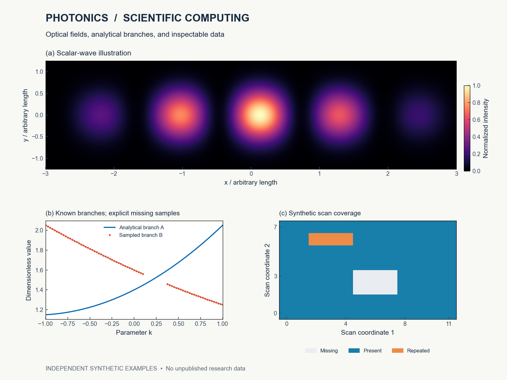
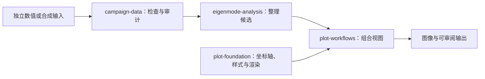

# 光子学、科学计算与科研工具

[English](README.md) · [个人网站](https://my1ab.fyi/zh) · [全部仓库](https://github.com/Patr1ck2005?tab=repositories) · [功能图导览](docs/visual-guide.md)

我围绕光子学、数值分析、科研可视化，以及连接这些工作的工具开展研究与开发，也制作交互实验和游戏。

[三分钟双语字幕导览](docs/demo/research-tools-tour.mp4) · [工具体系介绍](docs/tools-overview.zh-CN.md)

*这是由[附带代码](scripts/render_overview.py)生成的合成数值示意，属于数学例子，不是未发表研究结果或算法性能测试。*

## 代表作品

| 项目 | 解决的问题 |
|---|---|
| [eigenmode-analysis](https://github.com/Patr1ck2005/eigenmode-analysis) | 沿路径与网格整理候选本征值，保留缺失观察并检查诊断信息。 |
| [plot-workflows](https://github.com/Patr1ck2005/plot-workflows) | 将数值数组组织为能带、品质因数、偏振和多切片等关联视图。 |
| [MyOptics](https://github.com/Patr1ck2005/MyOptics) | 在文档说明的近似条件下探索光场、光学元件和数值传播。 |
| [gds-layout-kit](https://github.com/Patr1ck2005/gds-layout-kit) | 生成参数化GDS版图并检查几何。 |
| [EM-Flow](https://github.com/Patr1ck2005/EM-Flow) | 在浏览器中交互探索电磁波仿真；上游来源见项目说明。 |
| [Spirefall](https://github.com/Patr1ck2005/spirefall) | 独立游戏项目，可玩构建与开发状态以项目说明为准。 |

## 一条小型科研工具链

关系图说明公开组件的分工。每个项目分别记录支持的版本和实际示例，不据此推定全部可选集成已经实现。

## 完整项目目录

**科学分析与可视化**

- [eigenmode-analysis](https://github.com/Patr1ck2005/eigenmode-analysis)：路径/网格追踪与候选分组。
- [campaign-data](https://github.com/Patr1ck2005/campaign-data)：检查、审计和整理扫参文件。
- [plot-foundation](https://github.com/Patr1ck2005/plot-foundation)：科研绘图原语与显式导出。
- [plot-workflows](https://github.com/Patr1ck2005/plot-workflows)：可复用的分析与出图流程。
- [MyOptics](https://github.com/Patr1ck2005/MyOptics)：数值光学。
- [gds-layout-kit](https://github.com/Patr1ck2005/gds-layout-kit)：参数化版图生成。
- [EM-Flow](https://github.com/Patr1ck2005/EM-Flow)：基于明确上游来源的交互波动仿真。
- [EM-Visulization](https://github.com/Patr1ck2005/EM-Visulization)：电磁可视化，代码可获取情况见当前项目说明。

**软件与交互探索**

- [cs-demo-analyzer](https://github.com/Patr1ck2005/cs-demo-analyzer)：游戏录像分析。
- [Guandan-Intelligent](https://github.com/Patr1ck2005/Guandan-Intelligent)：牌类规则与决策实验。
- [Golf-Exploration](https://github.com/Patr1ck2005/Golf-Exploration)：交互轨迹探索。
- [numerical-psychology](https://github.com/Patr1ck2005/numerical-psychology)：现象学玩具模型，不属于心理学实证。
- [Physics-Puzzle](https://github.com/Patr1ck2005/Physics-Puzzle)：基于物理机制的游戏探索。
- [spirefall](https://github.com/Patr1ck2005/spirefall)：独立游戏项目。
- [wechat-qq-access](https://github.com/Patr1ck2005/wechat-qq-access)：本地消息读取基础设施及文档明确的授权边界。
- [wechat-qq-ai-panel](https://github.com/Patr1ck2005/wechat-qq-ai-panel)：读取底座的桌面界面。

**早期项目与学习资料**

- [MyExperimentToolkit](https://github.com/Patr1ck2005/MyExperimentToolkit)：早期实验工具，保留原仓库的许可政策。
- [FpsMaster-CS](https://github.com/Patr1ck2005/FpsMaster-CS)与[RL-CS](https://github.com/Patr1ck2005/RL-CS)：历史实验，用途与当前状态见原仓。
- [PhotonicTutorials](https://github.com/Patr1ck2005/PhotonicTutorials)：学习资料与来源索引。
- [Schoolworks-ComputationalPhysics](https://github.com/Patr1ck2005/Schoolworks-ComputationalPhysics)：课程作业与计算练习。
- [ModernOpticsDeepDeblur](https://github.com/Patr1ck2005/ModernOpticsDeepDeblur)：项目占位，不作为已经交付的工具展示。

**Fork与上游关系**

- [ripplegl](https://github.com/Patr1ck2005/ripplegl)：来自[pfalstad/ripplegl](https://github.com/pfalstad/ripplegl)。
- [chaos-battle](https://github.com/Patr1ck2005/chaos-battle)：来自[Aurora-b1t/chaos_battle](https://github.com/Aurora-b1t/chaos_battle)。

这里保留完整公开作品入口。活跃工具、课程、历史实验与fork具有不同的维护与许可条件，详细信息以对应仓库为准。

## 合作

我关注数值光学、科研数据分析、可视化和研究软件中的具体问题。可以从一份能够分享的小输入、希望得到的结果及适用条件开始讨论。

具体项目反馈可使用其已有GitHub入口。背景与公开作品见[my1ab.fyi](https://my1ab.fyi/zh)。
